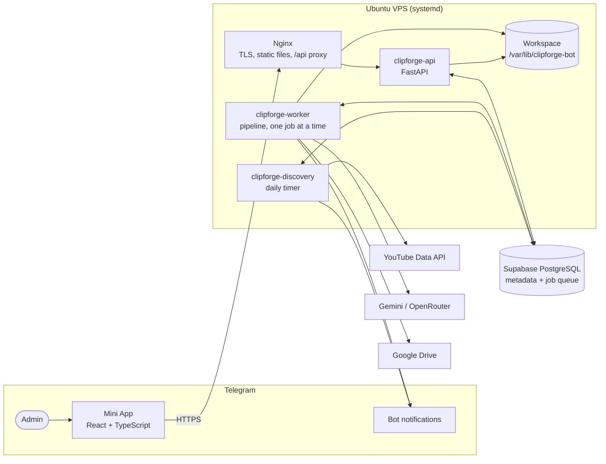

# ClipForge Bot

ClipForge Bot turns authorized long-form YouTube videos (30–120 minutes) into up to three
vertical short clips per video. It finds candidate videos through the YouTube Data API. It then
uses cloud AI to transcribe and score the best moments, renders 9:16 clips with burned-in
subtitles, stores them in Google Drive, and puts them up for review in a Telegram Mini App.
Optionally, it suggests affiliate products for each clip and builds captions that carry only
links the admin approved, plus a disclosure.

It is built for one administrator on one small VPS (2 vCPU, 4 GB RAM), targeting 5–20 videos
a day.

> **Authorized media only.** The YouTube API is used for *discovery metadata*, never for
> downloading. A video is processed only after the admin uploads the file or registers a
> permitted download URL, together with evidence of permission.

## How it works



1. **Discover.** Once a day, and on demand, discovery reads the trending chart for the
   configured region, picks the chart's top categories dynamically, and checks monitored
   channels. Videos of 30–120 minutes are stored, deduplicated by YouTube id.
2. **Authorize.** In the Mini App the admin uploads the source file (8 MiB resumable chunks) or
   registers a URL on the permitted-domain allowlist, with permission evidence. The file must
   pass format, duration and disk-space checks.
3. **Process.** The worker runs the job through a fixed stage pipeline (below), with every
   stage's result persisted so that it can resume.
4. **Review.** The admin gets a Telegram message listing the clips with their scores and the
   estimated AI cost. In the Mini App the admin then approves or rejects each clip, edits its
   title, opens it in Google Drive and, when affiliate links are on, approves product links
   and copies the caption.

### The processing pipeline

| Stage | What happens |
|---|---|
| `validated` | Source available locally (upload or SSRF-guarded download) and validated with ffprobe |
| `audio_extracted` | Mono speech-optimized audio, split into chunks for the AI provider |
| `transcribed` | Cloud transcription with word timings, merged across chunks |
| `analyzed` | Windowed AI analysis of the transcript plus sampled frames proposes scored candidates and titles |
| `candidates_selected` | Server-side scoring and selection of up to 3 clips |
| `rendering` | ffmpeg renders 720×1280 H.264/AAC MP4s with burned-in subtitles |
| `uploading` | Resumable, idempotent upload to Google Drive, verified by size and MD5 |
| `affiliate_matching` | Optional: embedding-based product suggestions per clip |

The scoring weights, clip rules and output format are defined in the
[spec](docs/SPEC-001-ClipForge-Bot.md).

## Architecture highlights

- **The job queue lives in PostgreSQL** (no Redis or Celery). Workers claim jobs with
  `SELECT … FOR UPDATE SKIP LOCKED` and hold a 5-minute lease, renewed by a heartbeat. Every
  write is *fenced* by the lease token and version, so a worker that lost its lease can't
  change anything. A crashed or killed worker's job is reclaimed and resumes from its last
  finished stage (ADR-005, ADR-006).
- **Errors are classified.** Transient errors (network, 5xx, timeouts) retry with backoff.
  Permanent errors (rights, invalid media) fail immediately. An exhausted AI quota defers the
  job until the provider's reset without using an attempt (ADR-007, ADR-028). Every failure
  produces a job event and a Telegram message; nothing fails silently.
- **Clips are never uploaded twice.** Drive files are tagged with the clip id, upload sessions
  are persisted, and an ambiguous completion is resolved by adopting the matching file
  (ADR-014).
- **AI providers sit behind adapters.** Transcription, analysis and embedding go through
  provider interfaces with a registry. Each job snapshots the settings and models in force
  when it starts, and records the usage and estimated cost of every call (ADR-009, ADR-024,
  ADR-026). Gemini is the primary provider and OpenRouter the analysis fallback (ADR-027).
- **Resource-aware media work.** All media work is done by ffmpeg/ffprobe through async
  subprocesses with timeouts, never by decoding video in Python. The worker runs one job at a
  time under a systemd `MemoryMax`. Disk admission keeps a free-space reserve (5 GB by
  default), and an optional `daily_job_cap` limits jobs per 24 hours (ADR-008, ADR-013).
- **Security by default:**
  - Mini App login is verified with Telegram `initData` (HMAC, freshness checks, rate
    limiting) and exchanged for short-lived session tokens. Every privileged route requires
    the admin (ADR-016).
  - The runtime database role has no DDL rights. RLS is enabled on every table, and
    Supabase's public API roles are blocked (ADR-003).
  - The Drive refresh token is encrypted at rest (ADR-015). Logs are structured JSON with
    secrets redacted (ADR-022).

Decisions and their reasoning live in [`docs/adr/`](docs/adr/README.md) (30 ADRs).

## Tech stack

| Layer | Technology |
|---|---|
| Backend | Python 3.12, FastAPI, Pydantic v2, SQLAlchemy 2 (async) + psycopg 3, Alembic running raw SQL migrations, httpx |
| Media | ffmpeg / ffprobe |
| Database | Supabase PostgreSQL (session pooler, verified TLS) |
| AI | Gemini (transcription, analysis, re-ranking, embeddings), OpenRouter (analysis fallback) |
| Frontend | React 19, TypeScript, Vite, TanStack Query, React Router; Telegram theme variables, no UI kit |
| Runtime | systemd services and timer, Nginx, Let's Encrypt; no Docker |
| Tooling | uv, ruff, mypy (strict), pytest + respx, ESLint, Vitest, GitHub Actions CI |

## Repository layout

```text
backend/
  clipforge/
    api/v1/        REST API (/api/v1): auth, sources, videos, uploads, jobs, clips, affiliate, settings, …
    auth/          Telegram initData verification, session tokens, rate limiting
    queue/         durable job queue: claim, lease, fence, retry
    pipeline/      stage runner and one module per stage (stages/)
    ai/            provider adapters, registry, quota guard, cost tracking
    media/         ffmpeg/ffprobe wrappers, rendering, subtitles
    ingest/        uploads, permitted-URL downloads, validation, disk admission
    discovery/     YouTube Data API client and discovery service
    storage/       Google Drive client and OAuth
    affiliate/     product matching, link review, caption export
    workers/       worker process entry point
    tools/         operational tools (benchmark report)
  migrations/      Alembic revisions that execute sql/NNN_*.sql
  tests/           unit, integration, e2e, reliability
frontend/          Telegram Mini App (src/pages, src/components, src/api)
deploy/            install.sh, systemd units, Nginx site, env templates, VPS guide
docs/              spec, ADRs, installation, runbook, backup/restore, reports
tasks/             implementation plan and task list
```

## Getting started (development)

Requirements: Python 3.12 with [uv](https://docs.astral.sh/uv/), Node.js ≥ 22.22, ffmpeg, and
a local PostgreSQL for integration tests.

```bash
# Backend
cd backend
uv venv --python 3.12
source .venv/bin/activate            # Windows: .venv\Scripts\activate
uv pip install -e ".[dev]"
export CLIPFORGE_TEST_DATABASE_URL=postgresql://postgres:<password>@localhost:5432/postgres
python -m pytest                     # creates and drops throwaway test databases
ruff check . && ruff format --check . && mypy clipforge

# Frontend
cd frontend
npm ci
npm run dev                          # Vite dev server
npm run lint && npx tsc --noEmit && npx vitest run && npm run build
```

Tests never call paid or live providers: external HTTP is mocked, and media fixtures are
generated with ffmpeg. Tests marked `live` are excluded by default, and
`python -m pytest -m security` runs the security suite.

Contributor rules (tooling, naming, code style, commit format) are in
[`AGENTS.md`](AGENTS.md).

## Deployment and operations

| Document | Purpose |
|---|---|
| [`docs/installation.md`](docs/installation.md) | Fresh VPS install, from accounts to the first processed video |
| [`docs/runbook.md`](docs/runbook.md) | Services, logs, stuck jobs, disk pressure, upgrades, rollback |
| [`docs/backup-restore.md`](docs/backup-restore.md) | Database dumps, secret escrow, restore into a new project |
| [`docs/security-checklist.md`](docs/security-checklist.md) | Security controls, accepted risks, secret rotation |
| [`deploy/README.md`](deploy/README.md) | Step-by-step VPS verification per milestone |
| [`docs/reliability-report.md`](docs/reliability-report.md), [`docs/benchmark-report.md`](docs/benchmark-report.md), [`docs/pilot-report.md`](docs/pilot-report.md) | Recovery scenarios, capacity measurements, 7-day pilot |

## Documentation

- [`docs/SPEC-001-ClipForge-Bot.md`](docs/SPEC-001-ClipForge-Bot.md): the product spec and the
  source of truth.
- [`docs/adr/`](docs/adr/README.md): architecture decision records.
- [`tasks/plan.md`](tasks/plan.md) and [`tasks/todo.md`](tasks/todo.md): implementation plan,
  tasks and acceptance criteria.
