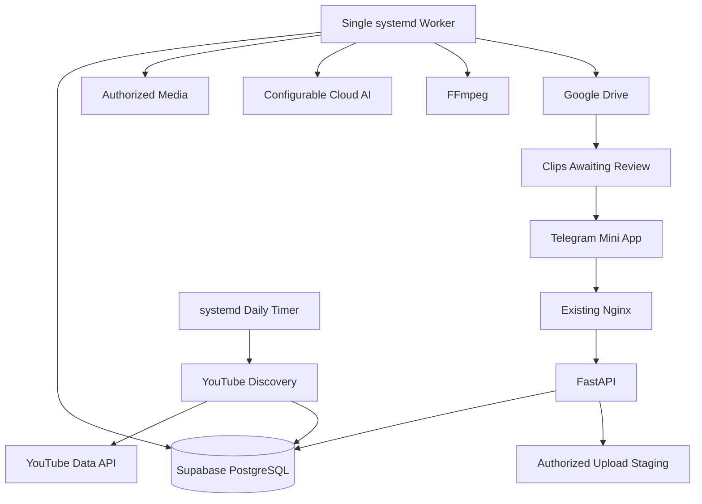
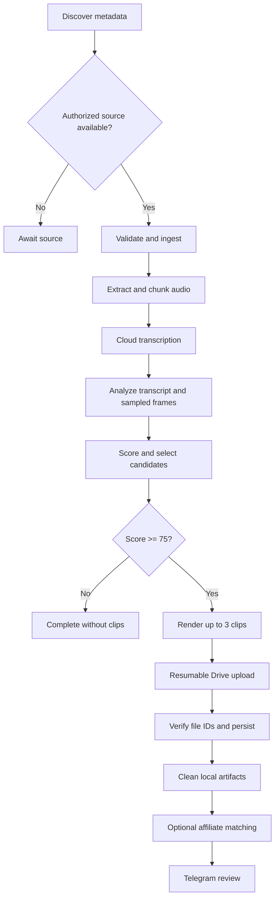

# SPEC-001 — ClipForge Bot: AI-Powered YouTube Viral Clip Automation

**Status:** Approved MVP Architecture  
**Version:** 1.1  
**Compiled by:** Abdul F. Tirtayasa (abdtirtayasa24)  
**Priority:** Backend and AI pipeline first

### Project naming conventions

| Component | Canonical name |
|---|---|
| GitHub repository | `clipforge-bot` |
| Project name | **ClipForge Bot** |
| Python package | `clipforge` |
| Linux service prefix | `clipforge-` |
| Supabase project name | `clipforge-bot` |
| Linux service account | `clipforge` |

The Supabase **project** is named `clipforge-bot`; the underlying PostgreSQL database may retain its provider-assigned name (commonly `postgres`). Do not rename the physical database unless the hosting configuration explicitly supports it.

## Background

Build a bot that discovers trending YouTube videos and monitors configured channels, analyzes authorized long-form media (30–120 minutes), identifies promising short highlights, creates up to three vertical clips, stores them in Google Drive, and presents them for review in a Telegram Mini App. When enabled, the bot also recommends relevant affiliate products and attaches approved affiliate links to clip metadata for use in captions or descriptions.

**Infrastructure:** Existing Ubuntu Linux VPS, 2 vCPU, 4 GB RAM, 20–30 GB disk; existing Nginx; native systemd services; Supabase PostgreSQL; cloud AI inference. Target 5–20 videos/day, subject to benchmarking.

YouTube Data API provides discovery metadata, **not permission or an API for arbitrary video downloads**. Only creator-authorized files and permitted download URLs may be ingested.

## Requirements

### Must Have

- **REQ-001:** Discover trending videos via YouTube Data API v3.
- **REQ-002:** Monitor configured YouTube channels.
- **REQ-003:** Run discovery once daily and on demand.
- **REQ-004:** Deduplicate videos and processing jobs.
- **REQ-005:** Ingest authorized file uploads and permitted download URLs.
- **REQ-006:** Verify authorization, media formats, and available disk.
- **REQ-007:** Transcribe audio through a configurable cloud AI provider.
- **REQ-008:** Analyze transcript and sampled scenes to rank highlight candidates.
- **REQ-009:** Produce up to three clips per video.
- **REQ-010:** Render 9:16 MP4 clips with subtitles.
- **REQ-011:** Upload and verify clips in Google Drive.
- **REQ-012:** Provide a Telegram Mini App for one administrator.
- **REQ-013:** Preview, approve, or reject clips before publishing.
- **REQ-014:** Persist jobs and recover interrupted processing.
- **REQ-015:** Run on the existing VPS with Nginx and systemd.
- **REQ-016:** Store application metadata in Supabase PostgreSQL.
- **REQ-017:** Provide an administrator-controlled affiliate-link feature toggle in the Telegram Mini App, default **off**.
- **REQ-018:** Match approved affiliate products to each clip using its transcript, title, topic, and keywords.
- **REQ-019:** Attach affiliate URLs and disclosure text to clip metadata and proposed captions/descriptions, subject to administrator review.

### Should Have

Telegram notifications; configurable AI models, thresholds, and durations; generated titles; retry controls; logs and AI cost tracking; safe temporary-file cleanup.

### Could Have

Alternative clips, subject-aware reframing, generated hashtags, additional providers, affiliate-network API imports, and multi-user support.

### Won't Have in MVP

Automatic social publishing, automatic affiliate-link creation from merchant APIs, link insertion directly into rendered video frames, local GPU inference, concurrent video processing, Redis/Celery, Docker/Kubernetes, or local PostgreSQL.

## Method

### Architecture



### Technology stack

| Layer | Choice |
|---|---|
| Frontend | React, TypeScript, Vite |
| Backend | Python package `clipforge`, FastAPI, Uvicorn |
| Database | Supabase PostgreSQL |
| ORM and migrations | SQLAlchemy, psycopg, Alembic |
| Authentication | Server-verified Telegram Mini App `initData` |
| Discovery | YouTube Data API v3 |
| AI | Provider-independent transcription and analysis adapters |
| Media | FFmpeg and ffprobe |
| Queue | PostgreSQL-backed durable job table |
| Scheduling | systemd timer |
| Service management | systemd |
| Reverse proxy | Existing Nginx |
| Storage | Google Drive API v3 |

Pin dependency versions after checking current official documentation and testing compatibility.

### Processing pipeline



### AI provider interfaces

```python
from typing import Protocol

class TranscriptionProvider(Protocol):
    async def transcribe(self, audio_path: str) -> "TranscriptResult": ...

class ViralAnalysisProvider(Protocol):
    async def analyze(
        self, transcript: "TranscriptResult", context: dict
    ) -> list["ClipCandidate"]: ...
```

Adapters normalize provider-specific results. Configure transcription and analysis separately. Keep credentials server-side and snapshot selected models for each job.

### Viral-potential scoring

Score each dimension on a 0–100 scale:

| Dimension | Weight |
|---|---:|
| Hook strength (H) | 25% |
| Emotional impact (E) | 20% |
| Standalone clarity (C) | 20% |
| Audience relevance (R) | 15% |
| Visual engagement (V) | 10% |
| Clip completeness (F) | 10% |

`Score = 0.25H + 0.20E + 0.20C + 0.15R + 0.10V + 0.10F`

Default minimum score: 75. Clip duration: 20–60 seconds. Up to three clips per source, with at most 20% overlap. Output: 720×1280 MP4, H.264/AAC, burned subtitles. This is a ranking heuristic, **not a calibrated probability of going viral**.

### Database entities

| Table | Responsibility |
|---|---|
| `admin_users` | Telegram administrator identity |
| `youtube_sources` | Trending and channel source configurations |
| `video_sources` | Many-to-many discovery source associations |
| `videos` | Video metadata, eligibility, rights status |
| `media_assets` | Permitted URLs, uploaded files, checksums, permission evidence |
| `processing_jobs` | Durable queue, stages, attempts, leases, settings snapshot |
| `job_events` | Immutable stage and error history |
| `clip_candidates` | Timestamp ranges, scores, explanations |
| `clips` | Generated clips, Drive IDs, review status |
| `clip_artifacts` | Local artifacts, upload state, checksums |
| `clip_reviews` | Approval/rejection audit trail |
| `ai_provider_configs` | Provider, model, capability, secret reference |
| `provider_usage` | Provider latency, tokens, cost |
| `app_settings` | Bot settings |
| `oauth_credentials` | Encrypted Google Drive refresh token |
| `affiliate_products` | Admin-curated products, URLs, tags, status |
| `clip_affiliate_links` | Ranked product suggestions and per-clip approval |
| `affiliate_events` | Audit log of recommendations and review actions |

Use UUID primary keys, foreign keys, constraints, and appropriate indexes. Implement all entities in production migrations; the earlier initial SQL draft is only a starting point. Do not expose privileged Supabase credentials to the Mini App. Use a dedicated least-privilege database role, TLS, and appropriate Supabase grants/RLS.

### Job claiming and recovery

One worker claims one eligible job at a time with PostgreSQL `FOR UPDATE SKIP LOCKED`, sets `lease_token`, increments `lease_version`, and sets a five-minute lease. Renew approximately every 60 seconds. Persist stage results and enforce lease fencing on writes. Expired leases may be reclaimed; stale workers cannot overwrite newer state.

Use bounded exponential retry delays (roughly 1, 5, 15 minutes plus jitter). Do not retry permanent rights/validation errors. Reuse durable stage artifacts after a restart, verify checksums, and reconcile ambiguous Google Drive upload completion before creating another file.

### API contract

All endpoints start with `/api/v1`.

| Method | Endpoint | Action |
|---|---|---|
| POST | `/auth/telegram` | Validate Telegram identity, establish session |
| GET | `/dashboard` | Statistics |
| GET/POST | `/sources` | List/create discovery sources |
| PATCH/DELETE | `/sources/{id}` | Update/disable source |
| POST | `/discovery/run` | Manual discovery |
| GET | `/videos` | Discovered videos |
| POST | `/videos/{id}/media` | Register permitted URL |
| POST | `/uploads` | Initialize file upload |
| PATCH | `/uploads/{id}` | Upload chunk |
| POST | `/uploads/{id}/complete` | Validate completed upload |
| POST | `/videos/{id}/jobs` | Queue processing, idempotently |
| GET | `/jobs` | List jobs |
| GET | `/jobs/{id}` | Job detail |
| POST | `/jobs/{id}/retry` | Retry |
| POST | `/jobs/{id}/cancel` | Request cancellation |
| GET | `/clips` | List clips |
| GET | `/clips/{id}` | Clip detail |
| POST | `/clips/{id}/review` | Approve/reject |
| GET/PATCH | `/settings` | Configuration |
| GET | `/ai/providers` | Provider capabilities |
| GET | `/integrations/drive/status` | Drive connection status |
| GET | `/integrations/drive/connect` | Begin OAuth |
| GET | `/integrations/drive/callback` | Complete OAuth |
| GET/POST | `/affiliate/products` | List/add affiliate catalog products |
| PATCH/DELETE | `/affiliate/products/{id}` | Edit/disable catalog products |
| GET | `/clips/{id}/affiliate-links` | List suggested/approved product links |
| POST | `/clips/{id}/affiliate-links/{link_id}/review` | Approve/reject suggestion |
| POST | `/clips/{id}/affiliate-links/rematch` | Recompute suggestions |
| GET | `/health/live` | Liveness |
| GET | `/health/ready` | Readiness |

Require Telegram admin authentication on privileged routes; verify signed `initData`, freshness, and administrator ID. Enforce idempotency keys for job creation.

### Optional affiliate product link attachment

**MVP behavior:** Administrator-curated affiliate product catalog, topic-based recommendations, and per-clip approval. The bot does **not** invent product URLs, automatically join affiliate programs, or publish links to social platforms.

**Feature flag:** `app_settings.affiliate_links_enabled` (JSON boolean; default `false`). The Telegram Mini App **Settings → Affiliate Links** switch controls it. When disabled, skip matching and do not include affiliate URLs in generated caption/description exports; retain previously approved records for audit and allow the administrator to remove them. When enabled, match eligible catalog products after clip analysis, then show suggestions during clip review. Each clip can have up to **three suggestions**, with **one selected primary link** by default. The administrator may reject all suggestions or manually select a catalog product.

**Matching inputs:** Clip transcript segment, AI topic summary, keywords, and suggested title. First filter active catalog products by language/region and relevant tags/categories, then rank by semantic similarity (provider adapter or keyword fallback). Apply a configurable minimum relevance score (default `0.70`), and exclude unrelated or prohibited products. Never invent a link if there is no match. Treat scores as ranking heuristics, not conversion predictions.

**Schema addition (migration `006_affiliate_links.sql`):**

```sql
CREATE TABLE affiliate_products (
    id UUID PRIMARY KEY DEFAULT gen_random_uuid(),
    name TEXT NOT NULL,
    merchant TEXT NOT NULL,
    affiliate_url TEXT NOT NULL,
    destination_domain TEXT NOT NULL,
    category TEXT,
    tags TEXT[] NOT NULL DEFAULT '{}',
    language_code TEXT,
    region_code VARCHAR(2),
    active BOOLEAN NOT NULL DEFAULT true,
    created_at TIMESTAMPTZ NOT NULL DEFAULT now(),
    updated_at TIMESTAMPTZ NOT NULL DEFAULT now()
);

CREATE TABLE clip_affiliate_links (
    id UUID PRIMARY KEY DEFAULT gen_random_uuid(),
    clip_id UUID NOT NULL REFERENCES clips(id) ON DELETE CASCADE,
    product_id UUID NOT NULL REFERENCES affiliate_products(id),
    relevance_score NUMERIC(4,3) NOT NULL
        CHECK (relevance_score BETWEEN 0 AND 1),
    match_reason TEXT,
    status TEXT NOT NULL DEFAULT 'suggested'
        CHECK (status IN ('suggested','approved','rejected')),
    is_primary BOOLEAN NOT NULL DEFAULT false,
    reviewed_at TIMESTAMPTZ,
    created_at TIMESTAMPTZ NOT NULL DEFAULT now(),
    UNIQUE (clip_id, product_id)
);

CREATE UNIQUE INDEX idx_one_primary_affiliate_per_clip
ON clip_affiliate_links (clip_id)
WHERE is_primary = true AND status = 'approved';

CREATE TABLE affiliate_events (
    id BIGINT GENERATED ALWAYS AS IDENTITY PRIMARY KEY,
    clip_id UUID NOT NULL REFERENCES clips(id) ON DELETE CASCADE,
    affiliate_link_id UUID REFERENCES clip_affiliate_links(id),
    event_type TEXT NOT NULL,
    details JSONB NOT NULL DEFAULT '{}',
    created_at TIMESTAMPTZ NOT NULL DEFAULT now()
);
```

**Link security and compliance:** Accept only `https://` affiliate URLs, validate allowed merchants/domains and redirects, block private-network/loopback destinations and unsafe schemes, and avoid fetching untrusted destinations from the worker. Preserve merchant-provided tracking parameters without logging sensitive tokens. The administrator is responsible for using authorized affiliate links and complying with each affiliate program and destination platform's rules. Add a clearly visible affiliate disclosure to exported captions/descriptions (for example, “Affiliate link — I may earn a commission from qualifying purchases.”). Do not misrepresent products as featured in the clip if they are merely related recommendations.

**Clip output contract:** Keep the MP4 unchanged. Store approved product name, merchant, URL, disclosure, and relevance reason alongside clip metadata; generate a copyable caption/description draft containing only approved links when the feature is enabled. The Mini App shows suggested matches, their reasoning, and approve/reject actions. Publishing remains manual.

**Acceptance:** With toggle off, no new affiliate matches or link-bearing exports are produced. With toggle on, a relevant approved catalog item can be suggested and approved; unrelated items are excluded; rejected links are never exported; no match results in a clip without an affiliate link.

### Google Drive lifecycle

Create deterministic clip identity → initiate resumable upload → stream chunks → verify file metadata and size → persist Drive file ID → delete local clip → notify Telegram. Keep files private by default. Never delete the only local copy before remote verification.

### Resource limits

| Setting | Initial value |
|---|---|
| Concurrent source jobs | 1 |
| FFmpeg render concurrency | 1 |
| Encoding threads | Up to 2 |
| Worker memory ceiling | 1.8 GB |
| Worker CPU quota | 170% |
| Reserved free disk | At least 5 GB |
| Clips per source | Up to 3 |
| Daily discovery | Once at 03:00 VPS timezone |

Admission-check projected disk use before ingesting large media. Reject/defer oversized sources or use authorized range-based acquisition if supported. Avoid storing full-resolution media unnecessarily.

## Implementation

### Phase 1 — Linux and application foundation

Install Python, FFmpeg, Git, and PostgreSQL client build dependencies. Reuse existing Nginx. Create dedicated `clipforge` service account and directories:

- `/opt/clipforge-bot/backend/`
- `/var/www/clipforge-bot/`
- `/var/lib/clipforge-bot/workspace/`
- `/etc/clipforge-bot/backend.env`

```bash
sudo apt update
sudo apt install -y python3 python3-venv python3-pip ffmpeg git curl ca-certificates build-essential libpq-dev
sudo useradd --system --home /opt/clipforge-bot --shell /usr/sbin/nologin clipforge
sudo mkdir -p /opt/clipforge-bot/backend /var/www/clipforge-bot /var/lib/clipforge-bot/workspace /etc/clipforge-bot
sudo chown -R clipforge:clipforge /opt/clipforge-bot /var/lib/clipforge-bot
sudo chmod 700 /var/lib/clipforge-bot/workspace
```

### Phase 2 — Supabase migrations

Implement and test:

1. `001_initial.sql` — Core entities.
2. `002_job_recovery.sql` — Leases, fencing, job events.
3. `003_artifacts.sql` — Media and clip artifact lifecycle.
4. `004_security.sql` — Privileges, indexes, restrictions.
5. `005_settings.sql` — Default settings and AI provider configuration.

Use Alembic for migration execution. Runtime role must not have schema modification privileges.

### Phase 3 — Backend and AI pipeline (highest priority)

Use `backend/clipforge/` as the importable Python package. Entrypoints are `clipforge.main:app`, `python -m clipforge.workers.main`, and `python -m clipforge.discovery_cli`. Use `clipforge-api.service`, `clipforge-worker.service`, `clipforge-discovery.service`, and `clipforge-discovery.timer`.

Implement Telegram authentication, YouTube discovery, authorized media ingestion, AI adapters, timestamp normalization, scoring, candidate selection, job leasing/recovery, FFmpeg, and Drive uploads. Validate one full 60–120 minute video end-to-end before building the complete frontend.

### Phase 4 — Native systemd

Required units:

- `clipforge-api.service`: FastAPI/Uvicorn on `127.0.0.1:8000`, one process.
- `clipforge-worker.service`: One long-running worker, `MemoryMax=1800M`, `CPUQuota=170%`, automatic restart.
- `clipforge-discovery.service`: One-shot discovery CLI.
- `clipforge-discovery.timer`: `OnCalendar=*-*-* 03:00:00`, `Persistent=true`.

Example activation:

```bash
sudo systemctl daemon-reload
sudo systemctl enable --now clipforge-api.service
sudo systemctl enable --now clipforge-worker.service
sudo systemctl enable --now clipforge-discovery.timer
sudo systemctl list-timers clipforge-discovery.timer
```

Store environment secrets in `/etc/clipforge-bot/backend.env`, owned by root with restricted group read. Use systemd `EnvironmentFile` for backend and worker.

### Phase 5 — Existing Nginx integration

Integrate into the existing HTTPS virtual host, without replacing its TLS configuration:

```nginx
root /var/www/clipforge-bot;
index index.html;

location /api/ {
    proxy_pass http://127.0.0.1:8000;
    proxy_set_header Host $host;
    proxy_set_header X-Real-IP $remote_addr;
    proxy_set_header X-Forwarded-For $proxy_add_x_forwarded_for;
    proxy_set_header X-Forwarded-Proto $scheme;
    proxy_connect_timeout 10s;
    proxy_read_timeout 60s;
}

location / {
    try_files $uri $uri/ /index.html;
}

client_max_body_size 10m;
```

Large uploads use bounded chunks, not one large multipart request. Verify `sudo nginx -t` before reloading.

### Phase 6 — Telegram Mini App

Implement dashboard, source management, job list/detail, clip preview/review, **Affiliate Links on/off toggle, affiliate product catalog, suggested product review, and copyable affiliate-aware captions**, provider settings, Google Drive connection status, and Telegram notifications. All privileged operations pass through FastAPI.

### Phase 7 — Reliability and handover

Test crash recovery, upload reconciliation, disk admission, auth rejection, API timeouts, retry behavior, **affiliate-toggle behavior, link validation, relevance, approval, and disclosure**, and resource consumption. Deliver source code, migrations, service units, Nginx snippet, installation guide, backup and restore guide, and operations runbook.

## Milestones

| Milestone | Deliverable | Estimate |
|---|---|---:|
| M1 | Infrastructure and backend foundation | 4–5 days |
| M2 | Discovery and authorized media ingestion | 5–6 days |
| M3 | AI transcription and viral analysis | 6–7 days |
| M4 | FFmpeg and Google Drive | 5–6 days |
| M5 | Telegram Mini App and affiliate product controls | 7–9 days |
| M6 | Integration and reliability testing | 4–5 days |
| M7 | Production deployment and handover | 2–3 days |

**Revised total:** 33–41 working days; approximately 7–9 weeks for one full-time developer, depending on affiliate matching and integration testing. Backend/AI work precedes full frontend implementation.

### Acceptance criteria

- **M1:** API starts under systemd, migrations apply, admin authentication succeeds.
- **M2:** Daily discovery works, media authorization and ingestion are enforced, duplicates are prevented.
- **M3:** Long video produces valid timestamped and scored candidates.
- **M4:** Up to three clips render and upload with verified Drive IDs and no duplicates.
- **M5:** Administrator can configure, monitor, preview, approve, and reject in Telegram, and manage affiliate products, toggle matching, and approve links.
- **M6:** Recovery, authorization, resource limits, and benchmarks pass.
- **M7:** System operates unattended; documentation and recovery procedures are delivered.

## Gathering Results

Run a seven-day pilot on representative authorized source videos.

| Metric | Acceptance target |
|---|---|
| Scheduled discovery | 7/7 runs |
| Eligible processing success | ≥90% |
| Duplicate Drive uploads | 0 |
| Unauthorized admin access | 0 successful attempts |
| Clip duration compliance | 100% |
| Maximum clips per source | ≤3 |
| Reserved free disk | ≥5 GB |
| Crash recovery | Recover or fail visibly |
| Clip usability | ≥70% rated usable by administrator |
| Verified Drive metadata | 100% of completed clips |
| Affiliate toggle off | 0 link-bearing exports or new suggestions |
| Affiliate link approvals | 100% of exported links explicitly approved |
| Affiliate disclosure | 100% of exported affiliate captions include disclosure |

Measure per-stage latency, total processing time, CPU, RAM, peak disk use, upload duration, AI usage/cost, clips per source, and affiliate recommendation acceptance rate. Establish whether the VPS can sustainably process 5, 10, or 20 videos/day. Recalibrate viral ranking after obtaining actual publishing and engagement data.

**Production readiness:** All Must Have requirements, critical security tests, resource safeguards, and recovery tests pass; contractor delivers complete source code and runbooks.
